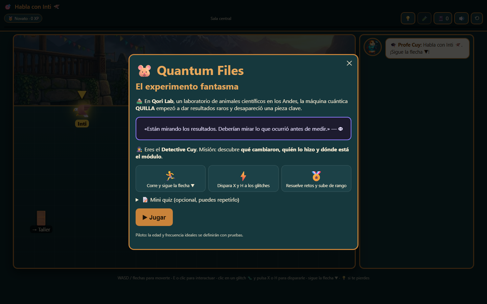
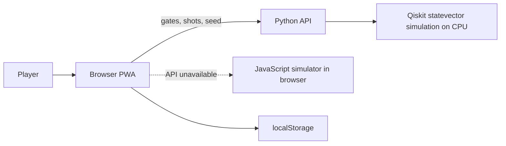

# Quantum Files — The Phantom Experiment

**Investigate a mystery. Experiment with quantum circuits. Follow the evidence.**

Quantum Files is a Spanish-language educational detective game that brings introductory quantum computing into an interactive story. Created by **Qubit a la Brasa** for IBM Quantum | Qiskit Fall Fest 2026, it invites players to explore a fictional lab and reason about measurements through play.

[](https://www.python.org/) [](https://www.ibm.com/quantum/qiskit)

**[Play the live demo](https://quantum-files.vercel.app/)** · **[Portfolio fork](https://github.com/LE0ST/quantum-files)** · **[Original repository](https://github.com/LuisTE1/ibmquantumhackathon)** · **[Documentation index](docs/README.md)**



## Overview

At Qori Lab, an unexpected change to an experiment sets Detective Cuy on an investigation. Players explore rooms, talk to characters, collect evidence and reconstruct circuits to understand what happened. The experience runs in the browser as a progressive web app (PWA), with keyboard and touch controls.

## The Educational Challenge

Quantum concepts can feel abstract when probabilities and circuit diagrams are presented without context. The game uses a mystery to give players a reason to predict, experiment and interpret evidence. Its intended learning goals include distinguishing theoretical probability from observed frequency and explaining the effect of basic gates. These are design goals, not measured learning outcomes; external educational validation remains pending.

## Key Features

- A story-driven investigation with dialogue, objectives and an evidence notebook.
- Interactive one-qubit challenges involving H and X gates, predictions and measurements.
- Result counts and visualizations labeled with their simulation source.
- Repeatable challenges, hints, points, streaks and badges, plus an optional pre/post quiz.
- Keyboard and touch controls, local progress storage, and PWA support.

## Gameplay and Quantum Concepts

Players encounter a qubit initially prepared in `|0⟩`, apply gates and compare predictions with sampled measurements. An H gate creates equal probabilities of measuring 0 or 1; two consecutive H gates without an intervening measurement return `|0⟩` to `|0⟩`. X swaps `|0⟩` and `|1⟩`. A small sample can differ from the theoretical probabilities, so measurement counts alone do not establish what happened in the story.

## Tech Stack

| Layer | Technology |
| --- | --- |
| Interface | HTML, CSS and vanilla JavaScript; PWA manifest and service worker |
| Simulation API | Python 3.12+, Qiskit `Statevector` and `StatevectorSampler` |
| Browser fallback | Independent JavaScript one-qubit simulator |
| Storage and hosting | Browser `localStorage`; Vercel static hosting and Python function |
| Tests | pytest; Node.js for the JavaScript comparison |

## System Architecture



The API calculates ideal probabilities and samples counts using Qiskit on a classical computer. If the API is unavailable, the browser uses a separate JavaScript simulator and labels the source. Neither path uses quantum hardware. The current episode does not train a quantum machine learning model. See [architecture](docs/ARQUITECTURA.md) and [limitations](docs/LIMITACIONES.md).

## Getting Started

From the repository root, with Python 3.12 or later:

```bash
python -m pip install -r web/requirements.txt
python web/serve_local.py
```

Open <http://localhost:8765>. This serves the interface and the local Qiskit API. To explore only the static interface with the JavaScript fallback:

```bash
python -m http.server 8765 --directory web/public
```

The PWA lives in `web/`. The Streamlit application in `app.py` and `engine/`, along with the case JSON files, are legacy or reference materials; the PWA keeps its narrative and quiz in JavaScript. The [documentation index](docs/README.md) separates current documents from historical records.

## Testing and Current Limitations

To run the web simulation tests from the repository root:

```bash
python -m pip install -r web/requirements.txt
python -m pip install pytest
python -m pytest -q tests/test_web.py
```

Node.js is needed for the test comparing the JavaScript simulator with Qiskit; that comparison is skipped if Node is unavailable. Browser tests have additional requirements described in [tests/e2e/README.md](tests/e2e/README.md). See [validation](docs/VALIDACION.md) for the historical test record; test results depend on the environment and must be verified for each run.

The simulation models an ideal single qubit and does not model noise or physical hardware. The four team members tested the prototype internally, but no quantitative learning results were recorded, and external evaluation is pending. Accessibility and browser compatibility have not been formally audited. Quiz forms are not equivalent measures, and progress is stored locally on the device. More detail is available in [limitations](docs/LIMITACIONES.md).

## Team and My Contributions

**Qubit a la Brasa** built this project collaboratively:

- Maricielo Rubi Antúnez de Mayolo Seminario
- Luis Giovani de la Cruz Hoyos
- Leonardo Sait Yactayo Tolentino
- Luis Hernando Tataje Espinoza

**Leonardo Sait Yactayo Tolentino's contribution** focused on educational content, pedagogical design, interactive storytelling and technical documentation. The project reflects the collective work of all four members.

## Acknowledgments and References

Detective Cuy, the llama and the Andean background reuse artwork from the team's earlier *Juego_HTA* / Hack the Andes project; ownership and licenses for reused assets should be confirmed before distribution beyond the hackathon. The team reports using Claude Code during implementation and OpenAI Codex for review and documentation, with the team responsible for decisions and content. No software license is added by this portfolio edition.

- [Sources, dependencies and credits](docs/FUENTES.md)
- [Pedagogical design](docs/PEDAGOGIA.md) · [Validation protocol](docs/VALIDACION.md) · [Integration status](docs/ESTADO-INTEGRACION.md)
- [Qiskit Statevector](https://quantum.cloud.ibm.com/docs/en/api/qiskit/qiskit.quantum_info.Statevector) · [StatevectorSampler](https://quantum.cloud.ibm.com/docs/en/api/qiskit/qiskit.primitives.StatevectorSampler)
